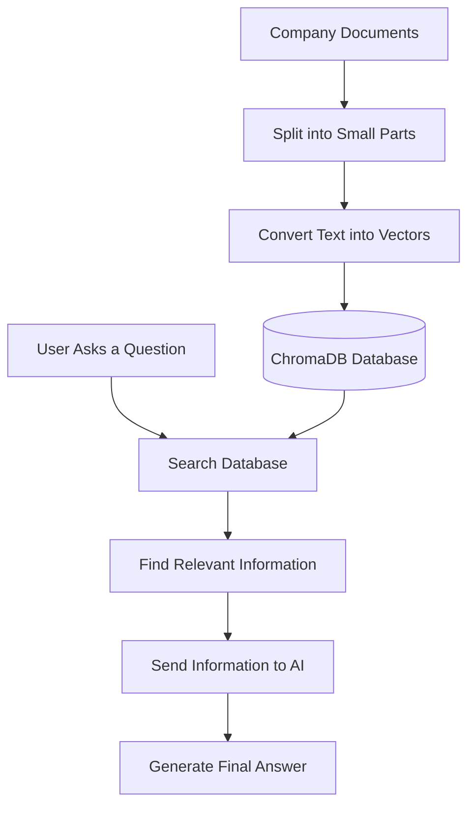

# RAG Architecture in Simple English

## What is RAG?

RAG stands for **Retrieval-Augmented Generation**.

RAG helps AI answer questions using information from our own documents, files, or database.

**Example:** We store company employee policies in ChromaDB. When someone asks, “What is the leave policy?”, AI finds the relevant information and gives an answer.

## How RAG works

## Main components of RAG

1. **Documents:** Collect information from PDFs, text files, or company documents.
2. **Chunking:** Divide large documents into small parts.
3. **Embeddings:** Convert text into numbers that represent its meaning.
4. **Vector Database:** Store the text and its vectors in a database such as ChromaDB.
5. **Retrieval:** Find the information related to the user's question.
6. **LLM (AI Model):** Use the retrieved information to generate an answer.

## Simple example

Suppose the company document says:

> Employees should request leave in advance.

The user asks: **“How can I take leave?”**

- **Step 1:** The user asks a question.
- **Step 2:** ChromaDB searches for relevant information.
- **Step 3:** It finds the leave policy.
- **Step 4:** The AI reads the information.
- **Step 5:** The AI answers: “You should request leave in advance.”

## Why do we use RAG?

- It helps AI answer questions using our own data.
- It can provide information from company documents.
- It reduces the need to retrain an AI model whenever documents change.
- It can reduce incorrect answers when the AI uses relevant information.

## Remember this simple flow

**Documents → Database → Search → AI → Answer**
